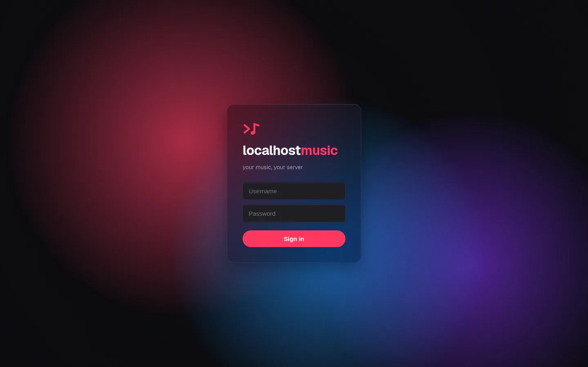
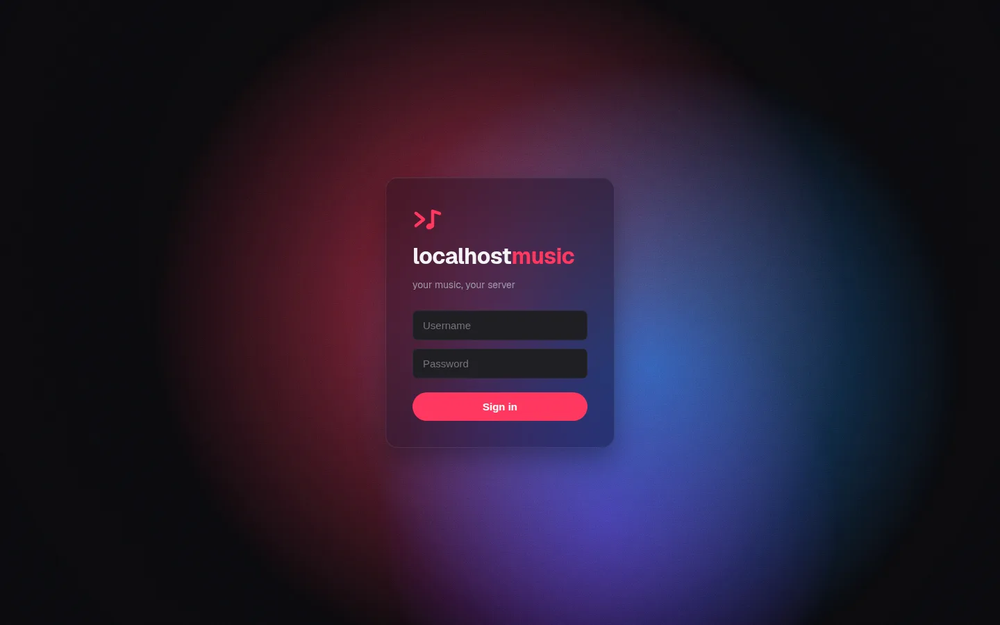
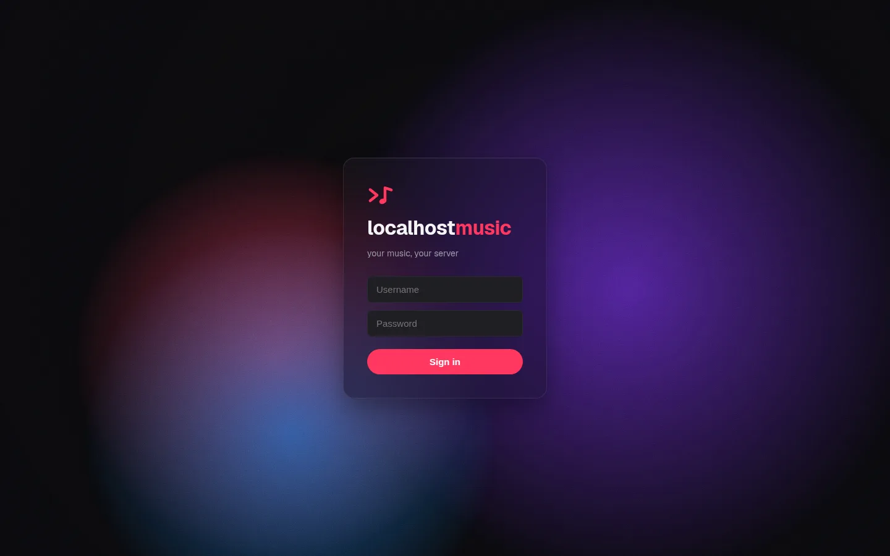
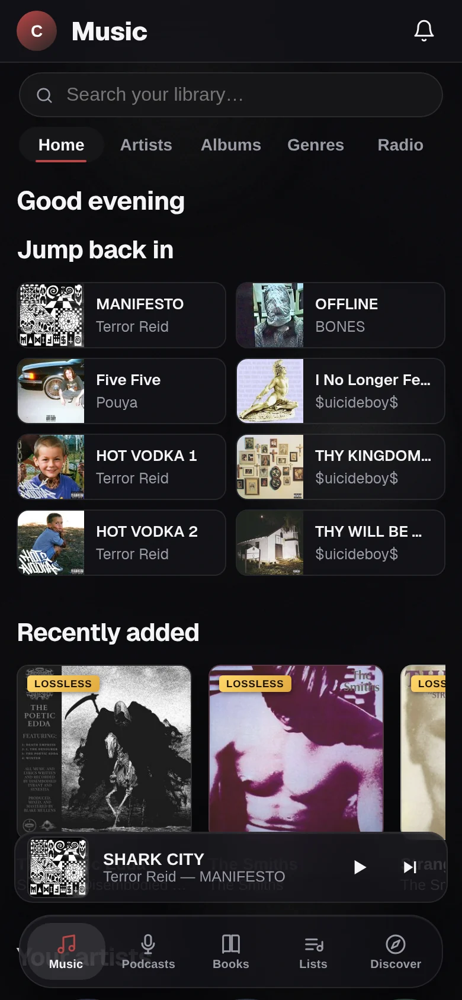
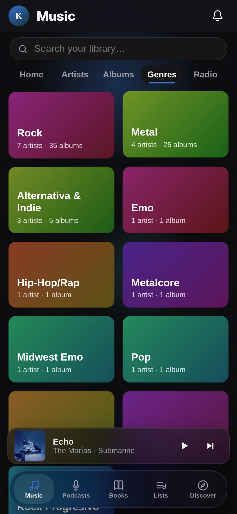
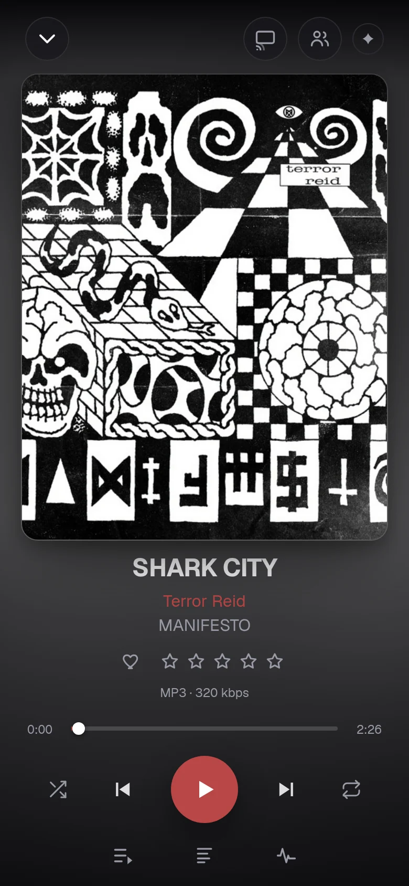

# Localhost Music

A self-hosted music server with its own web player. Point it at a folder of audio
files and stream your library to a browser, a phone, a desktop app or a TV.



 

  

Most music servers ship an API and leave the player to third-party clients. Localhost Music is
the server and the player in one process: one Docker image, SQLite, no other services.
It also speaks the Subsonic API, so existing Subsonic apps work with it.

## Features

Library and playback
- Scans MP3, FLAC, M4A, OGG, Opus and WAV into SQLite. Rescans are incremental.
- Browse by artist, album or genre. Full-text search (SQLite FTS5).
- Gapless playback, crossfade, shuffle, repeat, loudness normalization.
- Range streaming for instant seeking, optional ffmpeg transcoding with a cache.
- Playlists, smart playlists, favorites, star ratings.
- Podcasts, internet radio and audiobooks.

Player
- Full-screen player with synced lyrics (from LRCLIB), visualizers and a waveform.
- A tap-to-sync tool for writing your own synced lyrics when no database has them.
- OS media controls and lock-screen controls through the Media Session API.

Devices
- Installable PWA. Albums and playlists can be downloaded for offline play.
- Connect: control playback on one device from another, or hand it off.
- A TV interface at `/tv`, driven by a remote or by your phone.

Metadata
- Scrobbling to Last.fm and ListenBrainz, per user, opt-in.
- Artist photos, banners and bios fetched from public sources.
- A tag fixer that looks up a release on MusicBrainz and writes tags back to the file.
- Listening stats and a discovery feed.
- Every feature that calls an outside service can be turned off by the admin.

Accounts
- Multiple users, created by the admin. No public signup.
- Users can request missing music and report bad metadata.

## Desktop app

The quickest way to try it. Download the installer for Windows or Linux from the
[releases page](https://github.com/localhostmusic/localhostmusic/releases), open it,
and choose your music folder. The app runs its own server in the background, only
reachable from your computer, and updates itself when a new release is out.

If you already run a server, the same app can connect to it instead.

To stream to your phone, TV or other computers, run the server (Docker, below).

## Apps

The web app is the main client. The others are thin shells around it.

| Target | Where | Notes |
| ------ | ----- | ----- |
| Web / PWA | any browser | Installable, works offline. |
| Desktop | [`desktop/`](desktop) | Electron. Built-in server or a remote one. Tray icon, media keys. |
| Android | [`web/android/`](web/android) | Capacitor, with native audio (Media3) and lock-screen controls. |
| Android TV | [`tv-app/`](tv-app) | WebView around `/tv` with d-pad navigation. |

The Android and TV apps ask for your server's address on first run.

## Quick start (Docker)

1. Put your music in `./music` (or edit the volume in `docker-compose.yml`).
2. Optionally set `ADMIN_PASSWORD` in `docker-compose.yml` (otherwise one is generated).
3. Build and run:
   ```bash
   docker compose up --build
   ```
4. Open <http://localhost:8585> and sign in as `admin` / your `ADMIN_PASSWORD`.
   (Leave `ADMIN_PASSWORD` unset and Localhost Music generates a random one and prints it to the
   log on first run: `docker compose logs localhostmusic`.)

The music folder is mounted read-write so Localhost Music can write metadata fixes back to
your files. Change the volume to `:ro` to keep it read-only (those admin actions are
then disabled). The library DB and art cache live in the `lhm-data` volume.

> [!IMPORTANT]
> Before exposing Localhost Music outside your machine: change `ADMIN_PASSWORD`, and set
> `TRUST_PROXY=1` if it runs behind a reverse proxy (so the login throttle sees the
> real client IP and the session cookie gets its `Secure` flag).
>
> You do *not* need to pick a `JWT_SECRET`: Localhost Music generates a strong one on first run
> and stores it in `DATA_DIR/.jwt-secret`. It refuses to start on a placeholder value
> like `change-me`: a secret published in this repo would let anyone forge an admin
> session on your server.
>
> The cover and artist-image endpoints are intentionally auth-free so OS media widgets
> can fetch artwork: album/artist art is readable by anyone who can reach the server.


## Backup, restore and upgrade

Everything Localhost Music knows lives in `DATA_DIR` (the `lhm-data` volume in Docker):
the SQLite database (users, playlists, play history, ratings, lyrics, metadata fixes),
the session secret, and image caches. Your music files are never modified except by
explicit admin metadata fixes.

| In `DATA_DIR` | Back it up? |
| ------------- | ----------- |
| `lhm.db` (+ `-wal`, `-shm`) | Yes. This is your library state. |
| `.jwt-secret` | Yes. Without it, every device is signed out (nothing else is lost). |
| `artist-images/`, `playlist-covers/`, `user-avatars/`, `podcasts/` | Yes. Uploaded or curated, not always re-fetchable. |
| `covers/`, `thumb-cache/`, `transcode-cache/`, `disco-*` | Optional. Caches; rebuilt on demand. |

Back up. Stop Localhost Music first so the database is consistent (it runs in WAL mode;
copying a live `lhm.db` without its `-wal` file can lose recent changes):

```bash
docker compose stop localhostmusic
docker run --rm -v localhostmusic_lhm-data:/data -v "$PWD":/backup alpine \
  tar czf /backup/lhm-backup-$(date +%F).tgz -C /data .
docker compose start localhostmusic
```

(The volume name is `<project>_lhm-data`; check with `docker volume ls`.) Without
Docker, stop the service and copy the `DATA_DIR` folder.

Restore. Stop Localhost Music, empty the volume, unpack the archive into it, and start again:

```bash
docker compose stop localhostmusic
docker run --rm -v localhostmusic_lhm-data:/data -v "$PWD":/backup alpine \
  sh -c 'rm -rf /data/* /data/.[!.]* ; tar xzf /backup/lhm-backup-YYYY-MM-DD.tgz -C /data'
docker compose start localhostmusic
```

Upgrade. Back up first, then:

```bash
git pull
docker compose up -d --build
docker compose logs -f localhostmusic     # migrations run automatically on startup
```

Database migrations are forward-only. Once a newer Localhost Music has opened your database,
an older build refuses to start on it rather than risk corrupting it. To roll back,
restore the backup you made before upgrading.


## Configuration

All configuration is via environment variables.

| Variable | Default | Purpose |
| -------- | ------- | ------- |
| `MUSIC_DIR` | `/music` | Folder to scan for audio. |
| `DATA_DIR` | `/data` | SQLite DB + cover / artist-image / thumbnail caches. |
| `JWT_SECRET` | _(generated + persisted)_ | Signing key for session cookies. Best left unset: Localhost Music mints a strong one on first run and stores it at `DATA_DIR/.jwt-secret`. Refuses to boot on a known placeholder (`change-me`). |
| `ADMIN_USER` | `admin` | Bootstrap admin username (created on first run). |
| `ADMIN_PASSWORD` | _(random, logged once)_ | Bootstrap admin password. If unset, a random one is generated and printed to the log on first run. |
| `RESET_ADMIN_PASSWORD` | _(unset)_ | Recovery for a forgotten admin password. Start once with it set (8 or more characters), sign in, then remove it. |
| `TRUST_PROXY` | _(off)_ | Set to `1` behind a reverse proxy (Caddy/nginx/Traefik/Cloudflare) to trust `X-Forwarded-For`/`-Proto`: the login throttle then sees the real client IP, and the session cookie gets `Secure` on https. Leave off if directly exposed, or clients could spoof those headers. |
| `COOKIE_SECURE` | _(auto)_ | Force the session cookie's `Secure` flag on (`1`) or off (`0`). Defaults to following the request scheme. |
| `PORT` | `8585` | HTTP port. |
| `LASTFM_API_KEY` / `LASTFM_API_SECRET` | _(none)_ | Enable Last.fm scrobbling + its rich metadata ([get a key](https://www.last.fm/api/account/create)). ListenBrainz needs no server config. |
| `FANART_API_KEY` | _(none)_ | Optional free [fanart.tv](https://fanart.tv/get-an-api-key/) key for wide landscape banners. |
| `AUDIODB_API_KEY` | `2` | [TheAudioDB](https://www.theaudiodb.com/api_guide.php) key for artist images (defaults to the free test key). |
| `ANDROID_PACKAGE` / `ANDROID_FINGERPRINT` | _(none)_ | Enables `/.well-known/assetlinks.json` for an installed Android TWA. |

Scrobbling and online lookups are opt-in. Nothing is
sent to a third party unless a user connects an account or an admin leaves the feature
on.


## Development

The backend runs on `:3000` and Vite on `:5173`, proxying `/api` to the backend.
`ffmpeg` must be on `PATH` for transcoding.

```bash
cd server
cp .env.example .env    # set MUSIC_DIR
npm install
npm run dev

cd web
npm install
npm run dev             # http://localhost:5173

cd server && npm test
cd web && npm test
```

## How it is built

- Server: Fastify 5, better-sqlite3, argon2, music-metadata, sharp, system ffmpeg.
  TypeScript. An optional Go scanner (`server/scanner-go`) speeds up large libraries.
- Web: React 19, Vite, TypeScript. Plain CSS, no UI framework.
- One Docker image builds both and serves the web app from the Fastify process.
- Database migrations run on startup.

```
server/src/
  routes/     HTTP API, plus the Subsonic API under /rest
  realtime/   Connect: multi-device sync over WebSocket
  scanner/    filesystem scan and tag parsing
  lib/        auth, transcoding, thumbnails, metadata lookups
  db/         schema and migrations
web/src/
  player/     playback engine, queue, Now Playing, lyrics, visualizers
  library/    artists, albums, audiobooks
  ui/         shared components
  ...         one folder per page
desktop/      Electron shell
web/android/  Android shell
tv-app/       Android TV shell
```

## External services

All calls are made by the server, and each one is behind an admin switch or a user
connecting an account.

| Service | Used for |
| ------- | -------- |
| [Last.fm](https://www.last.fm/api) | Scrobbling, artist bios and tags, similar artists |
| [ListenBrainz](https://listenbrainz.org) | Scrobbling, listening stats |
| [LRCLIB](https://lrclib.net) | Synced lyrics |
| [MusicBrainz](https://musicbrainz.org) | Tag fixes, discographies |
| [Cover Art Archive](https://coverartarchive.org) | Album art |
| [Deezer](https://api.deezer.com) | Artist photos, related artists, new releases |
| [TheAudioDB](https://www.theaudiodb.com) | Artist photos and banners |
| [fanart.tv](https://webservice.fanart.tv) | Banners (optional key) |
| [Wikidata](https://www.wikidata.org) | Artist bios and photos |

## Roadmap

See [ROADMAP.md](ROADMAP.md).

## License

[GNU AGPL v3](LICENSE). Use, modify and self-host it freely. If you run a modified
version as a network service, you must offer its source to its users.
